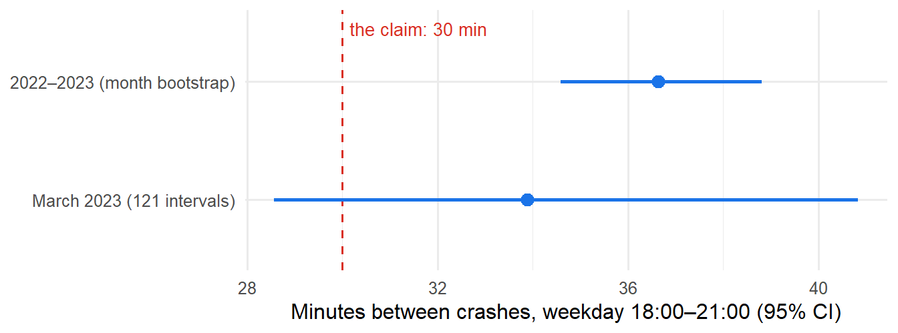
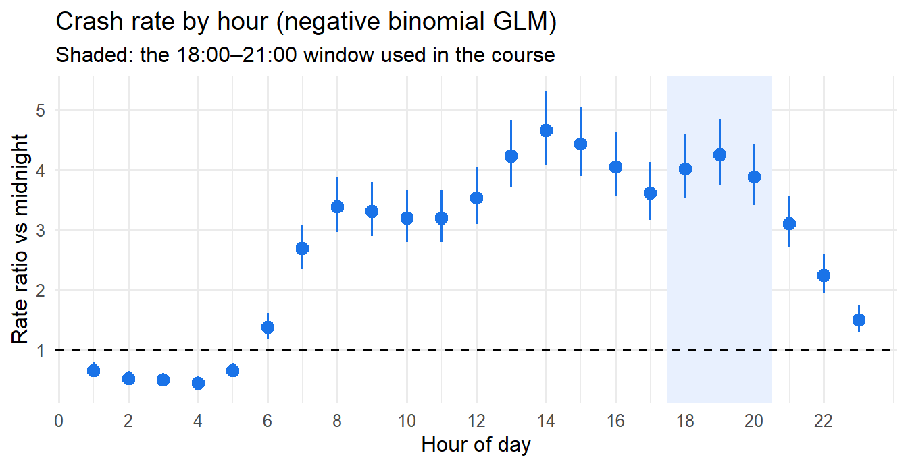

# Is someone hit by a car every 30 minutes in Mexico City?

**Testing a popular claim with two years of emergency-call records, and the three data traps that almost gave the wrong answer.**

📊 [Full report](https://amaugomez.github.io/cdmx-pedestrian-crashes/)

*Author's note: this analysis is the backbone of the Statistical Inference course I teach at the Facultad de Ciencias, UNAM (syllabus 1541). Each chapter answers one part of the question with the tools of one unit of the syllabus; a final chapter goes beyond the course with frequency GLMs. The chapters are in Spanish; the report summarises them in English.*

---

## The answer

A common saying in Mexico City: *"at rush hour, someone is hit by a car every half hour."* Tested as $\mu = 30$ minutes between confirmed pedestrian crashes, weekdays 18:00–21:00, using the C5 emergency centre's open data:

| Data | Mean minutes between crashes | 95% CI | Conclusion |
|---|---|---|---|
| March 2023 (121 intervals) | 33.9 | 28.6–40.8 | Not rejected (exact χ² test, p = 0.16), but power against 35 min was only 42% |
| **2022–2023** (2,554 intervals) | **36.6** | **34.6–38.8** (month bootstrap) | **Rejected** (z = 6.1): 1.64 crashes per hour, not 2; the claim overstates the frequency by about 22% |



## Three traps

1. **The observation window biases the answer, and every diagnostic missed it.** Measuring intervals only inside each evening discards the time before the first crash and after the last one. In a simulated Poisson process with a true mean of 35 min it estimates 26.9 min, and the biased data *still pass* the histogram, Q-Q plot and goodness-of-fit checks. On the real data it gives 27 min, which would reverse the conclusion. Fix: a "rush-hour clock" that stitches evenings together, justified by memorylessness and checked against the exposure estimator.
2. **The same crash, confirmed twice.** Among reports less than 10 min apart, 10.4% were within 500 m, against about 0.3% for random pairs. Removing these near-duplicates fixed the exponential fit (bootstrap-calibrated KS: p < 0.001 → 0.65).
3. **Months are not exchangeable, and a standard test did not notice.** The dispersion index on daily counts did not reject (p ≈ 0.10); a χ² test of equal monthly rates did (p = 0.0002). The two-year interval therefore uses a bootstrap over months. A GLM shows the variation is seasonal.

## Beyond the course: a frequency model

A negative binomial GLM fitted to all hours of 2022–2023 (18,442 confirmed crashes), the same model insurers use for claim frequency:

- **The evening rush is not the riskiest time of day.** The rate is high from 13:00 to 20:00, about four times the rate at midnight, and peaks around 14:00.
- **The denominator decides the conclusion:** per resident, Cuauhtémoc has 3.8 times the rate of Iztapalapa, but most people walking there do not live there.
- **Out-of-sample validation (Jan–Feb 2024, by borough):** 29 of 32 observations fall inside the 90% prediction intervals, yet the total is underpredicted by 7% because early 2022 was atypically low. Validating at a single level would have missed it.



## How the analysis unfolds

The project is also a course: each chapter answers one part of the question with one unit of the syllabus. Chapters are in Spanish; click to read them rendered.

| | Chapter | What it finds |
|---|---|---|
| 0 | [The question](https://amaugomez.github.io/cdmx-pedestrian-crashes/chapters/0-la-pregunta.html) | Turns the saying into a testable parameter: the mean time between confirmed crashes, weekdays 18:00–21:00 |
| 1 | [Sampling distributions](https://amaugomez.github.io/cdmx-pedestrian-crashes/chapters/1-distribuciones-muestrales.html) | The exact distribution of the sample mean and an exact χ² pivot; normal-theory tests fail on data this skewed (the t test doubles its error rate) |
| 2 | [Exploratory analysis](https://amaugomez.github.io/cdmx-pedestrian-crashes/chapters/2-analisis-exploratorio.html) | The three traps: window bias, duplicate confirmations, non-homogeneous months; checks of independence and identical distribution |
| 3 | [Point estimation](https://amaugomez.github.io/cdmx-pedestrian-crashes/chapters/3-estimacion-puntual.html) | Moments, maximum likelihood and Bayesian estimates agree (≈34 min in March 2023); the mean is efficient and the minimum-variance unbiased estimator |
| 4 | [Confidence intervals](https://amaugomez.github.io/cdmx-pedestrian-crashes/chapters/4-intervalos-de-confianza.html) | Exact and approximate intervals and their simulated coverage; with one month 30 min is plausible, with two years it is not |
| 5 | [Hypothesis testing](https://amaugomez.github.io/cdmx-pedestrian-crashes/chapters/5-pruebas-de-hipotesis.html) | Power analysis explains why one month was not enough; the final test rejects the claim (z = 6.1) |
| 6 | [Frequency models](https://amaugomez.github.io/cdmx-pedestrian-crashes/chapters/6-modelos-de-frecuencia.html) | Negative binomial GLM with exposure: risk is high all afternoon, not just at rush hour; the denominator problem across boroughs, out-of-sample validation on 2024 |

Source code for every chapter is in [`chapters/`](chapters/).

## Reproduce it

```r
Rscript run_all.R   # downloads ~100 MB of public data on the first run
```

The processed files in `chapters/datos/` are included, so the chapters also run without the download. Shared functions are in [`chapters/funciones-caso.R`](chapters/funciones-caso.R).

**Data:** *Incidentes viales reportados por C5*, Gobierno de la Ciudad de México ([datos.cdmx.gob.mx](https://datos.cdmx.gob.mx/dataset/incidentes-viales-c5), CC BY 4.0); population from the Censo de Población y Vivienda 2020 (INEGI).

## Skills shown

Poisson processes · exact and asymptotic inference · bootstrap · power analysis · likelihood-ratio tests · Bayesian conjugate updating · Poisson and negative binomial GLMs with exposure · out-of-sample validation · data-quality diagnostics · R · Quarto

---

Code: MIT License · Data: CC BY 4.0. Aaron Mauricio Gómez Jiménez · [LinkedIn](https://www.linkedin.com/in/amaugomezjimenez) · [ORCID](https://orcid.org/0009-0003-1099-0431)
